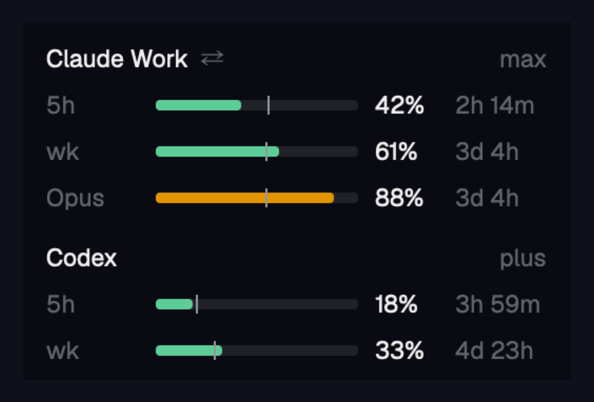
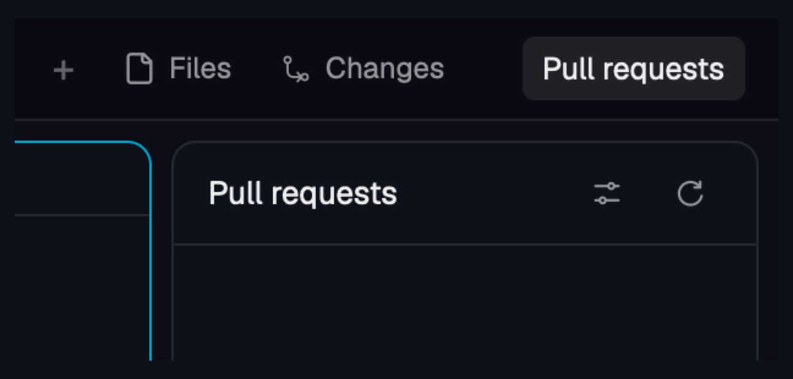

# Herdr mods

Two small mods for the [Herdr](https://herdr.dev) desktop app. Each folder holds one mod with its `RECIPE.md`, the brief an agent can rebuild it from.

They are unofficial and not affiliated with Herdr. See also [Machine Pulse](https://github.com/prakash-sr/herdr-machine-pulse), a CPU and memory card for the same sidebar.

## Usage card

Your plan limits as a card that stays in the sidebar: one row a limit with a bar, the percent used and the time to reset.



*The card with sample numbers.*

It is a companion to [usage-limits](https://github.com/nozikov/herdr-usage-limits), which shows the same limits in the status bar and on hover. That mod collects the numbers; this one only draws them, in a place that is always in view.

What it adds:

- **Always visible.** No hover: 5-hour, weekly and per-model limits for Claude Code, Codex and the other providers usage-limits knows, in the sidebar.
- **A pace mark on every bar.** The thin line is where the bar would be if you used the limit evenly until it resets, so one look says whether you are ahead of pace.
- **Account switch.** With several Claude accounts, a click on the account's name shows the next one, then all of them.
- **No cost of its own.** It reads what usage-limits already publishes in Herdr's shared state. It runs no program, reads no file and makes no request.
- **Sizes itself.** The block grows and shrinks with the limits shown.

Install (after usage-limits is in your layout):

```sh
git clone https://github.com/prakash-sr/herdr-mods
cp -R herdr-mods/usage-card/mods/usage-card ~/.config/herdr-app/mods/
```

Then add the block to the sidebar column of a layout of your own, for example above the sidebar footer:

```json
{ "id": "usage-card", "type": "block", "size": { "px": 82 }, "content": { "mod": "usage-card" } }
```

To name your accounts, give the block `"props": { "names": { "claude": "Work", "claude-personal": "Personal" } }`. The ids are the ones usage-limits gives its `claudeAccounts`.

## Layout toggle

A button that shows or hides one part of your layout: a side panel, a second sidebar, a bar. It is lit while that part is shown.



*"Pull requests" at the right of the tab bar, toggling a panel beside the terminals.*

Herdr's tab bar has buttons for its own Files and Changes panels. A panel another mod adds has no button, only a key if you bind one. This gives it one.

- **Any node.** It runs `layout.toggle` on the id you give it, so it works for any block, row or column.
- **Shows the state.** Lit while the node is shown, muted while hidden.
- **Place it anywhere.** One button a block; put several in a row.

```sh
cp -R herdr-mods/layout-toggle/mods/layout-toggle ~/.config/herdr-app/mods/
```

For a button at the right end of the tab bar, replace the `tabs` block of your own layout with a row:

```json
{ "id": "tabs-row", "type": "row", "size": { "px": 42 }, "resizable": false, "children": [
  { "id": "tabs", "type": "block", "size": { "weight": 1 }, "content": { "mod": "tabs" } },
  { "id": "pr-toggle", "type": "block", "size": { "px": 118 },
    "content": { "mod": "layout-toggle", "props": { "id": "pr-flow", "label": "Pull requests" } } } ] }
```

`id` is the layout node to toggle, `label` the button's text.

## License

MIT
