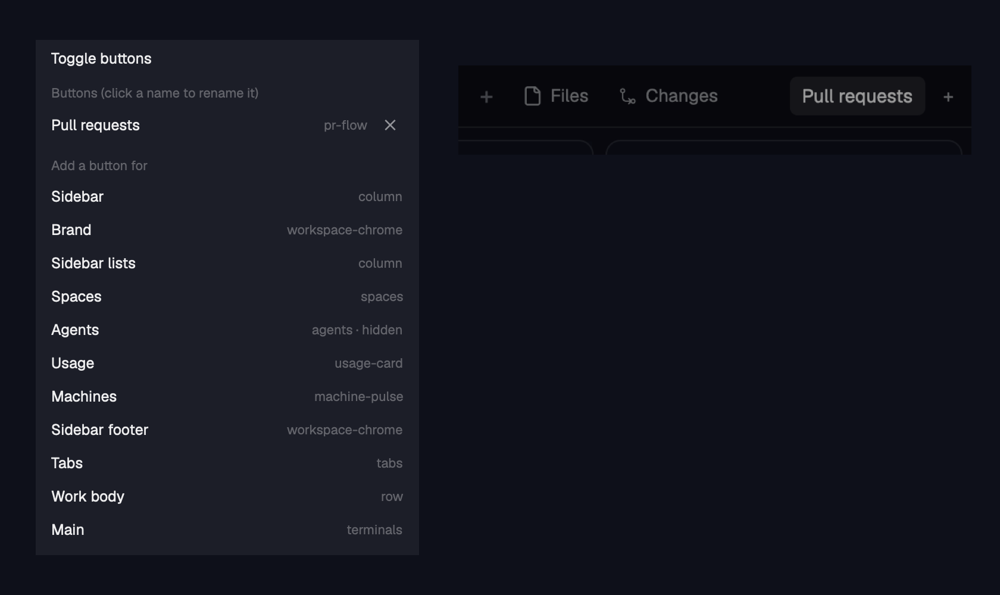

# Layout toggle

Buttons for any part of your layout, picked from a list. Herdr's tab bar has buttons only for its own Files and Changes panels; a panel another mod adds has none, just a key if you bind one. Layout toggle adds a row of small buttons, each showing or hiding one part of the layout and lit while that part is shown. Its settings list every part of the window to choose from, so nothing has to be written in a layout file.

## What you see

**The buttons** (a block on the `chrome` background with a 1 px bottom border, content right-aligned, 6 px side padding, 4 px between buttons): one button per chosen part, 8 px side padding, 3 px above and below, 5 px corners, text 12.5 px. Shown part: label in `foreground` on a `selected` background. Hidden part: label in `muted`, no background. Under the pointer a button takes the `hover` background. A last button, `+` in `muted`, opens the settings.

**The settings** (a dialog 330 px wide and 440 px high, `popover` background, text 12.5 px, scrolling): the title `Toggle buttons`; a section `Buttons (click a name to rename it)` with one row per button: its label, the part's id in `dim` 11 px, and a `✕`; then a section `Add a button for` listing every part that can get one: a label on the left, and in `dim` 11 px on the right what it holds (the mod's name, `terminals`, or `row` / `column` / `stack`) with ` · hidden` when it is not shown now. When the layout has no block of this mod, an outlined entry `Add the buttons to the tab bar` comes first.

## How it behaves

- A click on a button runs `layout.toggle` on its part. The buttons redraw when the layout changes, so they also follow a key or another mod toggling the same part. A part hidden by something above it (a hidden column) counts as hidden.
- A click on a part in the settings adds a button for it, labelled from a few known names (`pr-flow` is `Pull requests`) or from the id. It then leaves the list.
- A click on a button's name in the settings turns it into a text field; Enter saves the new label.
- `✕` removes the button; the part itself is untouched.
- Not offered: the window's root, the block the buttons are in and everything that contains it (hiding those would hide the buttons), and parts that already have a button.
- The block sets its own width from the labels.
- `Add the buttons to the tab bar` appends the block to the row `tabs-row`, or turns the block `tabs` into that row first.
- Opened by itself (`mod.open`), it shows the settings.

## Built from

- One mod, `mods/layout-toggle/`: `main.js` and `mod.json` (`{ "place": "none", "overlay": { "width": 330, "height": 440 } }`).
- The buttons are shared state under `layout-toggle.buttons`: `[{ id, label }]`.
- Props: none needed. `{ "view": "settings" }` is the settings. An older `{ "id", "label" }` becomes the first button when no buttons are stored yet.
- From `herdr`: `layout`, `props`, `run` (`layout.toggle`, `layout.resize`, `layout.set`), `shared`, `setShared`, `openOverlay`, `theme`, `checking`. From `gpui-base`: `InputState` and `Input` for the rename field.
- `test.mjs` runs the list of parts, adding and removing a button, the old props and the tab bar placement with the app's functions faked.

## Watch out

- Shipped layouts refuse structure changes, so `Add the buttons to the tab bar` needs a personal layout (`layout.clone`); `run` returns nothing, so the mod cannot tell that it was refused.
- That entry looks for the ids `tabs-row` and `tabs`. In other layouts, place the block by hand.
- All copies of the mod show the same buttons: they are one shared list, not per block.
- A hidden mod block that was never shown has not started; its mod begins when a button first shows it.
- Width is estimated from the label's length (7.4 px a character); very wide glyphs can clip. Don't call `layout.resize` on every render: only when the wanted width changed.
- The bottom border matches Herdr's tab bar. In another place, change or drop it.

## Done when

- `herdr-app check mods/layout-toggle` passes and `node test.mjs` prints `ok`.
- `mod.open` shows the settings; a click on a part adds its button to the bar, and the bar grows to fit.
- A button hides the part it names and shows it again, and is lit only while the part is shown.
- Renaming a button in the settings changes its label on the bar; `✕` removes it.
