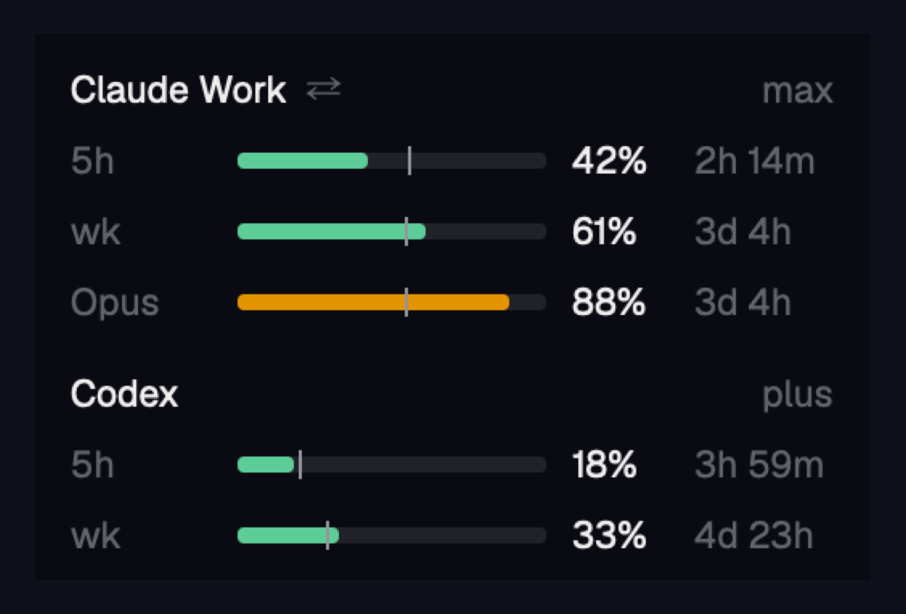

# Usage card

Plan limits as a card that stays in the sidebar: one row a limit with a bar, the percent used and the time to reset. It draws what the usage-limits mod collects.

## What you see

A sidebar block on the `chrome` background with a 1 px top border, 14 px side padding, 10 px above and below, text 11.5 px. One group per provider, 10 px apart:

- A title row: the provider's name in `foreground`, semibold, on the left; its plan (`max`, `plus`) in `dim` on the right, with ` · old` when the last report failed and an earlier one is shown.
- One row per limit, 18 px high: the limit's short name (`5h`, `wk`, `Opus`) in `dim`, 44 px wide; a 96 px by 5 px rounded track in `border`, filled to the percent used; the percent in `foreground`; the time to reset in `dim` (`2h 14m`, `3d 4h`).
- Fill color: `ansi2` (green) below 75%, `ansi3` (yellow) from 75%, `ansi1` (red) from 90%.
- A pace mark on each track: a 1 px by 9 px line in `muted` at the share of the limit's window that has passed.
- A Claude account with no limits shows one `dim` line with the reason usage-limits reported.

With more than one Claude account, the account's name is followed by `⇄` and takes the `hover` background under the pointer.

## How it behaves

- It redraws when usage-limits publishes new numbers, and once a minute so the time to reset moves on.
- With several Claude accounts it shows one at a time. A click on the name shows the next account, then all accounts, then the first again. The choice is shared state, so it survives a restart.
- Other providers (Codex, OpenCode Go, Antigravity) are shown when they have limits.
- The block sets its own height from the rows shown.
- Without usage-limits, or before its first report, it says `No limits yet (needs the usage-limits mod)`.

## Built from

- One mod, `mods/usage-card/`: `main.js` and `mod.json` (`{ "place": "none" }`).
- Props: `{ "names": { "<provider id>": "Label" } }`, optional.
- From `herdr`: `shared`, `setShared`, `layout`, `run` (`layout.resize`), `props`, `theme`, `checking`.
- Reads shared `usage-limits.state`: an object of providers, each `{ report, lastGood }`, a report being `{ status, plan, message, windows: [{ short, percent, resetsAt, durationSec }] }`. Claude accounts are the ids `claude` and `claude-<suffix>`.
- Writes shared `usage-card.account`: a Claude account id, or `all`.
- `test.mjs` runs the account switch with the app's functions faked.

## Watch out

- It depends on the shape of another mod's shared state. If usage-limits changes it, the card shows nothing or the wrong rows.
- usage-limits must be in the shown layout, or nothing is collected.
- It runs no program and makes no request itself; never add polling here.
- The pace mark needs `durationSec` and `resetsAt`; a limit without them gets no mark.
- Don't call `layout.resize` on every render: only when the wanted height changed.

## Done when

- `herdr-app check mods/usage-card` passes and `node test.mjs` prints `ok`.
- With usage-limits in the layout, the card shows each limit with a bar, a percent and a time to reset, and the block is as tall as its rows.
- With two Claude accounts, a click on the name goes to the second, then both, then the first.
- `herdr-app status` lists no errors.
